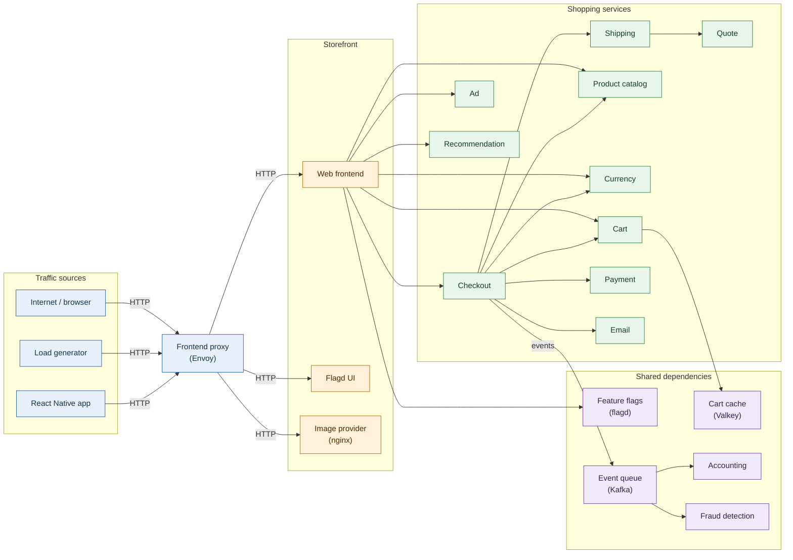

# OpenTelemetry Demo - AWS DevOps Project

This repository contains a cloud-native online shopping application built as a set of independently deployable microservices. It is based on the OpenTelemetry Demo and is intended for learning and demonstrating containerization, service-to-service communication, Kubernetes deployment, and observability.

The application models an online store: shoppers browse products, manage a cart, and complete purchases. The services use a mix of languages and communication styles, making the project useful for exploring distributed systems and end-to-end telemetry.

## Architecture



Arrows show request or event flow; the HTTP labels identify traffic into the frontend proxy. The Compose stack also includes OpenTelemetry collection and observability components, including Jaeger, Prometheus, Grafana, and OpenSearch.

## Run locally

Requirements: Docker with the Compose plugin.

Start the full demo from the repository root:

```shell
docker compose --env-file .env --env-file .env.override up --build
```

When the services are ready, open [http://localhost:8080](http://localhost:8080) (or the frontend port configured in `.env`). To stop the stack, run:

```shell
docker compose --env-file .env --env-file .env.override down
```

Building all services can take several minutes and requires Docker resources. The repository also includes `docker-compose.minimal.yml` for a smaller local stack.

## AWS infrastructure

The [`terraform/`](terraform/) directory contains Terraform modules for an AWS VPC and an Amazon EKS cluster with a managed node group. This infrastructure is separate from the application deployment: creating the cluster does not install the demo services into Kubernetes.

Read [`terraform/README.md`](terraform/README.md) for prerequisites, deployment steps, state handling, and cost notes. Review the plan before applying; AWS resources incur charges.

## Repository layout

| Path | Purpose |
| --- | --- |
| `src/` | Microservice and frontend source code |
| `kubernetes/` | Kubernetes manifests for the demo services |
| `docker-compose.yml` | Full local demo stack |
| `docker-compose.minimal.yml` | Reduced local demo stack |
| `test/` | Integration and trace-testing assets |
| `terraform/` | AWS VPC and EKS infrastructure |

## Project references

- [OpenTelemetry Demo](https://github.com/open-telemetry/opentelemetry-demo)
- [Ultimate DevOps Project - AWS](https://github.com/iam-veeramalla/ultimate-devops-project-aws) (source of the adapted EKS/VPC Terraform configuration)
