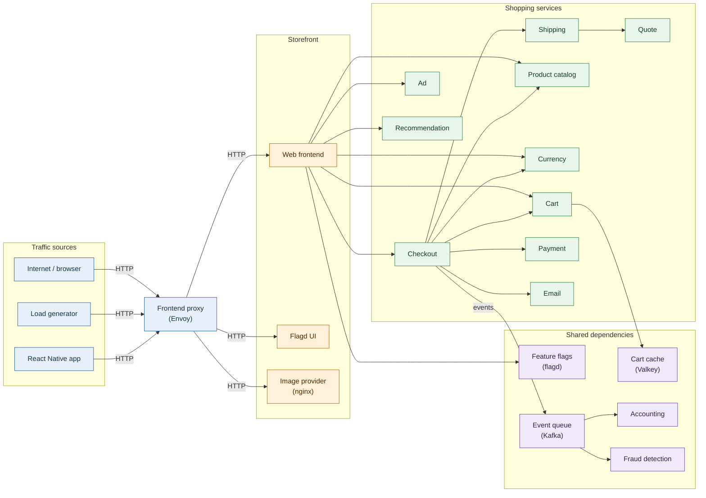

# OpenTelemetry Demo - AWS DevOps Project

This repository contains a sample online shopping application built from small services that work together. It is based on the OpenTelemetry Demo and is intended as a learning project for Docker, service-to-service communication, Kubernetes, AWS infrastructure, and application monitoring. It is a demo environment, not a production storefront.

## What is a microservice?

A microservice is a small program responsible for one part of an application. For example, the Cart service manages shopping carts, while the Product Catalog service provides product information. The services run as separate processes or containers and communicate over the network. Together, they behave like one store.

This design lets teams develop and deploy parts independently, but it also means a single customer action can involve several services. This project makes those connections visible so you can learn how a distributed application works.

## Architecture



This is a simplified map of the main request and event paths; not every Compose or monitoring component is drawn. A browser or app sends an HTTP request to Envoy, which routes it to the frontend. The frontend and backend services then communicate with one another; many internal calls use gRPC (a way for programs to call one another over a network). Some work is sent as events through Kafka instead of waiting for another service to finish.

### Example: placing an order

1. The shopper opens the site. Envoy receives the request and forwards it to the web frontend.
2. The frontend gets product, currency, recommendation, and advertising information from the relevant services.
3. When the shopper adds an item to the cart, the Cart service saves the cart in Valkey, a fast in-memory data store.
4. At checkout, Checkout coordinates the Cart, Product Catalog, Currency, Shipping, Payment, and Email services.
5. Order events can be sent through Kafka. Accounting and Fraud Detection consume those events separately, so that background work does not have to happen as part of the shopper's page request.
6. OpenTelemetry collects information about the requests as they pass between services. The observability tools help you inspect what happened and where.

### What each service does

| Service | In plain language |
| --- | --- |
| **Frontend proxy (Envoy)** | The front door for the site and APIs. It routes incoming web traffic to the right component. |
| **Frontend** | The website the shopper sees and uses. |
| **Load Generator** | Creates simulated shopper activity so the demo has requests to observe. |
| **Ad** | Supplies advertisements shown by the storefront. |
| **Cart** | Adds, reads, and removes items in a shopper's cart. |
| **Product Catalog** | Provides the store's product list and details. |
| **Recommendation** | Suggests other products to the shopper. |
| **Currency** | Converts prices for display in different currencies. |
| **Checkout** | Coordinates the steps needed to place an order. |
| **Payment** | Demonstrates the payment step in the sample checkout. |
| **Shipping** | Provides shipping choices and works with Quote for shipping information. |
| **Quote** | Supplies quote information used by Shipping. |
| **Email** | Demonstrates sending an order-related email. |
| **Accounting** | Processes order events for accounting-related work. |
| **Fraud Detection** | Processes order events for fraud-detection-related work. |
| **Flagd / Flagd UI** | Provides feature flags (settings that can turn demo features on or off) and a UI for viewing them. |
| **Image Provider** | Serves product images to the storefront. |

### Shared infrastructure and monitoring

These components support the application; they are not all shopper-facing services:

| Component | Purpose |
| --- | --- |
| **Valkey** | Stores cart data for the Cart service. |
| **Kafka** | Passes events between services for asynchronous background work. |
| **PostgreSQL** | Database used by parts of the demo stack. |
| **OpenTelemetry Collector** | Receives and forwards telemetry (information about application activity). |
| **Jaeger** | Lets you inspect traces: a record of one request as it travels through multiple services. |
| **Prometheus** | Collects metrics: numeric measurements such as request counts and response times. |
| **Grafana** | Displays metrics and other monitoring data in dashboards. |
| **OpenSearch** | Supports searching and viewing log data in the demo stack. |

Together, traces, metrics, and logs help answer different questions: what happened during a request, how the application is performing, and what the services recorded.

## Run locally

Requirements: Docker Desktop (or Docker Engine) with the Docker Compose plugin, and enough memory for the containers.

From the repository root, start the full demo:

```shell
docker compose --env-file .env --env-file .env.override up --build
```

The first run builds the images and can take several minutes. Once the containers are healthy, open [http://localhost:8080](http://localhost:8080) in a browser. The port is configured by `FRONTEND_PORT` in `.env`.

To see whether the services are running, open a second terminal in the project directory and run:

```shell
docker compose --env-file .env --env-file .env.override ps
```

To stop the stack, run:

```shell
docker compose --env-file .env --env-file .env.override down
```

The repository also includes `docker-compose.minimal.yml` for a smaller local stack. The Compose file starts the application and its supporting services together; you do not need to start each microservice individually.

## Project structure

| Path | Purpose |
| --- | --- |
| `src/` | Source code for the frontend and individual microservices. Each service has its own folder. |
| `docker-compose.yml` | Instructions for building and running the full local stack and its dependencies. |
| `docker-compose.minimal.yml` | Instructions for a reduced local stack. |
| `kubernetes/` | Kubernetes manifests. The checked-in bundle targets an older demo version and should be updated before ArgoCD uses it for this source. |
| `test/` | Integration and trace-testing assets. |
| `terraform/` | Terraform modules for creating an AWS VPC and EKS cluster. This creates infrastructure; it does not deploy the app. |
| `argocd/` | ArgoCD Application and Kustomize overlay used to deploy the demo to EKS with images stored in ECR. |

For a first tour, run the app with Docker Compose, open the storefront, and follow the order flow above. Then compare a service folder in `src/` with its corresponding configuration in `kubernetes/`.

## Terraform and Kubernetes

These tools solve different problems:

| Tool | What it manages | In this project |
| --- | --- | --- |
| **Terraform** | Cloud infrastructure: the network and machines/platform to run on. | The [`terraform/`](terraform/) directory describes an AWS VPC and an Amazon EKS cluster with a managed node group. |
| **Kubernetes** | Containerized applications running on a cluster. | The [`kubernetes/`](kubernetes/) directory contains YAML manifests describing how Kubernetes should run and connect the demo services. |
| **Docker Compose** | Containers on one local machine. | The Compose files are the easiest way to try the full demo without creating AWS resources or a Kubernetes cluster. |

### What Kubernetes does

Kubernetes is a system for running containers across a group of machines (a *cluster*). You describe the desired setup in YAML, and Kubernetes works to keep the application in that state—for example, restarting a container if it stops.

The manifests in `kubernetes/` use a few common Kubernetes building blocks:

- A **Deployment** describes which container image to run and how many copies should be kept running.
- A **Service** gives a group of running copies a stable network address so other services can reach them.
- An **Ingress** describes how incoming web traffic reaches a service. This project has an ingress manifest for the frontend proxy.
- A **ConfigMap** provides non-secret configuration to an application; this project includes one for feature flags.

The files in this folder are application deployment instructions; they do not create the AWS cluster itself.

### What Terraform does

Terraform is an *infrastructure as code* tool. Instead of creating cloud resources by hand in the AWS console, you describe them in `.tf` files. Terraform can show a proposed change with `terraform plan`, then create or update resources with `terraform apply`.

Here, Terraform creates the AWS foundation: a VPC (a private network), public and private subnets, network gateways and routes, an EKS control plane (the Kubernetes management service), and a managed group of worker machines. The modules in `terraform/modules/` separate the VPC and EKS definitions so they are easier to understand and reuse.

**Important:** Terraform in this repository creates the AWS network and cluster; it does not build the application images or install the demo services into Kubernetes. Running the application on EKS also requires making its container images available to the cluster and applying the Kubernetes manifests. Those are separate deployment steps.

### How the pieces fit together

1. Use Docker Compose to learn and run the application locally; this does not need AWS.
2. If you want a cloud cluster, use Terraform to plan and create the AWS network and EKS infrastructure.
3. Make the application images available to that cluster, then deploy the Kubernetes manifests to run the services there.

Creating AWS infrastructure can incur ongoing charges, especially for EKS, NAT gateways, and worker machines. Read [`terraform/README.md`](terraform/README.md) for prerequisites and commands, review the plan before applying, and destroy resources when finished.

## DevOps deployment: end-to-end steps

This is the whole deployment path, from a code change to a running release:

```text
Developer change
  -> GitHub Actions PR checks
  -> merge to main
  -> GitHub Actions OR Jenkins builds/tests the source
  -> build 17 Docker images and push SHA-tagged images to ECR
  -> CI commits the new image tags to argocd/overlays/demo
  -> ArgoCD detects the Git change and syncs Kubernetes
  -> EKS worker nodes pull images from ECR and start the updated services
```

CI is responsible for testing and publishing images. ArgoCD is responsible for deploying the Kubernetes configuration; neither CI pipeline runs `kubectl apply` against the application.

### 1. Prepare AWS and provision EKS

Install AWS CLI, Terraform 1.5 or later, and `kubectl`. Configure AWS credentials with permission to create the required VPC, EC2, EKS, and IAM resources. Review [`terraform/README.md`](terraform/README.md), especially its AWS cost warning.

From the repository root, initialize and review the Terraform plan:

```shell
terraform -chdir=terraform init
terraform -chdir=terraform fmt -check -recursive
terraform -chdir=terraform validate
terraform -chdir=terraform plan
```

If needed, create a local `terraform/terraform.tfvars` to change the region, cluster name, Kubernetes version, subnet ranges, or node size. Do not commit credentials, `*.tfvars`, or state files. After reviewing the plan, create the infrastructure:

```shell
terraform -chdir=terraform apply
```

Configure `kubectl` for the cluster (replace the values if you changed the Terraform defaults):

```shell
aws eks update-kubeconfig --region us-west-2 --name my-eks-cluster
kubectl get nodes
```

The worker nodes need outbound access to pull the remaining public base images as well as read access to ECR. The Terraform node role includes `AmazonEC2ContainerRegistryReadOnly`.

### 2. Install ArgoCD in EKS

ArgoCD is a controller running in the cluster; it is not installed by Terraform or by the CI pipelines. Follow the [official ArgoCD getting-started guide](https://argo-cd.readthedocs.io/en/stable/getting_started/) to install it in the `argocd` namespace. For a learning cluster, the standard manifest-based installation is:

```shell
kubectl create namespace argocd
kubectl apply -n argocd -f https://raw.githubusercontent.com/argoproj/argo-cd/stable/manifests/install.yaml
kubectl get pods -n argocd
```

For production, pin and review a specific ArgoCD release and configure appropriate authentication and access controls.

### 3. Configure one CI publisher

Both publisher pipelines produce the same image tags and update the same Git branch. Configure **one automatic publisher at a time** to avoid duplicate builds or simultaneous Git pushes. The GitHub Actions PR workflow can still run when Jenkins is the publisher.

#### GitHub Actions

The PR workflow [`.github/workflows/ci.yaml`](.github/workflows/ci.yaml) checks out the code, builds and tests the Product Catalog Go service, and tests the GitOps image-tag updater. The publish workflow [`.github/workflows/publish-ecr.yml`](.github/workflows/publish-ecr.yml) runs on pushes to `main`; it can also be started manually from `main`. Its ordered steps are:

1. Check out the repository and set up Go.
2. Build and test Product Catalog; validate the tag updater.
3. Assume the AWS role through GitHub OIDC.
4. Create the ECR repository if needed and log in to ECR.
5. Build the 17 service Docker images with Docker Compose.
6. Tag and push the images to ECR.
7. Update the ArgoCD overlay to use the source commit SHA and push a `[gitops-only]` Git commit.

Configure these GitHub repository settings:

- Secret `AWS_ROLE_TO_ASSUME`: IAM role ARN. Configure its trust policy for this repository's GitHub OIDC identity and the `main` branch.
- Variables `AWS_REGION` and `ECR_REPOSITORY` are optional; defaults are `us-west-2` and `opentelemetry-demo`.
- The role needs ECR permissions to create/describe the repository, get an authorization token, and upload image layers and manifests. The workflow token already has `contents: write` for the GitOps commit.

#### Jenkins

Create a **Multibranch Pipeline** pointing at this repository so Jenkins reads [`Jenkinsfile`](Jenkinsfile). It polls Git every five minutes. Its ordered stages are:

1. Check the Linux agent has AWS CLI, Docker with the Compose plugin, Git, Go, and Python 3.
2. Detect a `[gitops-only]` commit to prevent a Git-trigger loop.
3. Check shell syntax and run the GitOps tag updater tests.
4. Build and test Product Catalog.
5. On `main` commits that are not GitOps-only: create the ECR repository if needed and log in.
6. Build the 17 service Docker images.
7. Tag and push the images to ECR.
8. Update the image tags in the ArgoCD overlay and push the resulting Git commit.

Give the Jenkins agent an AWS IAM role, or use Jenkins' secure credential store for AWS credentials; never put AWS keys in the `Jenkinsfile`. The AWS identity needs the same ECR permissions described above. Create a Jenkins **Username with password** credential with ID `github-gitops-write`; use the GitHub username and a token with write access to this repository. If you change the region or ECR repository, update the `environment` values in `Jenkinsfile`.

The shared [`scripts/publish-images-to-ecr.sh`](scripts/publish-images-to-ecr.sh) provides separate `login`, `build`, and `push` operations, which are called as visible pipeline steps. Both CI systems use full source commit SHA tags such as `<commit-sha>-cart`. The image tag updater changes all 17 app images to the same source revision.

### 4. Create the ArgoCD Application

Run one publisher successfully first. It creates ECR images and commits their tags to `argocd/overlays/demo/kustomization.yaml`. Then, from the repository root on a workstation with cluster access, register the application with ArgoCD:

```shell
kubectl apply -f argocd/application.yaml
```

The Application points ArgoCD to the `argocd/overlays/demo` directory, creates the `otel-demo` namespace if needed, and enables automatic sync, pruning, and self-healing. The overlay uses a version-pinned OpenTelemetry Demo Kubernetes bundle and replaces its app container images with this project's ECR images. It intentionally does not use the older `kubernetes/` bundle in this repository.

### 5. Verify the deployment and publish updates

Check ArgoCD and Kubernetes:

```shell
kubectl get applications -n argocd
kubectl get pods -n otel-demo
kubectl get services -n otel-demo
```

For each application change, open a pull request and let the PR checks pass. After merge to `main`, the configured publisher tests the Product Catalog, builds and pushes the service images, then commits the new tags. ArgoCD sees that commit and rolls out the updated deployments. GitOps-only commits are ignored by the publisher, so they do not trigger another image build.

### How the ArgoCD files fit together

- [`argocd/application.yaml`](argocd/application.yaml) tells ArgoCD which Git repository/path to watch and which cluster namespace to update.
- [`argocd/overlays/demo/kustomization.yaml`](argocd/overlays/demo/kustomization.yaml) pins the upstream Kubernetes base and overrides the 17 app image references.
- [`scripts/update-argocd-image-tags.py`](scripts/update-argocd-image-tags.py) validates and updates all image references; [`scripts/update-argocd-image-tags.sh`](scripts/update-argocd-image-tags.sh) discovers the AWS ECR URI and commits the change.

This is a learning setup, not a production-ready release process. Review the upstream manifests, image publishing permissions, Git branch protection rules, ArgoCD project permissions, and release strategy before using this pattern for production.

## Project references

- [OpenTelemetry Demo](https://github.com/open-telemetry/opentelemetry-demo)
